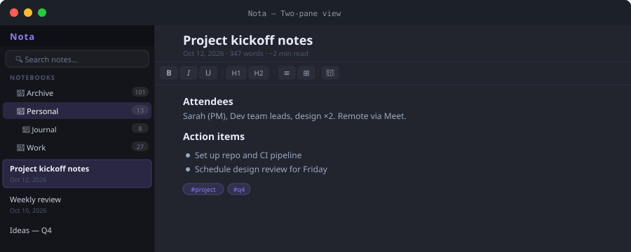
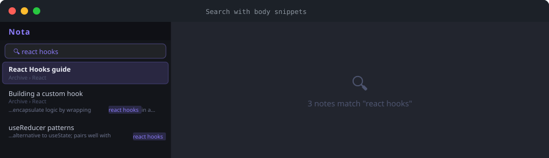
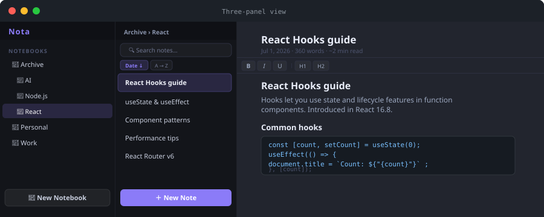

# Nota

> A self-contained, offline-first notes app — one HTML file, no server required.



[](#)
[](#)
[](#)

---

## Contents

1. [Getting Started](#getting-started)
2. [Notebooks & Organisation](#notebooks--organisation)
3. [The Editor](#the-editor)
4. [Markdown Shortcuts](#markdown-shortcuts)
5. [Search](#search)
6. [Three-Panel View](#three-panel-view)
7. [Import & Export](#import--export)
8. [Themes & Appearance](#themes--appearance)
9. [Keyboard Shortcuts](#keyboard-shortcuts)
10. [Settings Reference](#settings-reference)

---

## Getting Started

Nota is distributed as a **single HTML file**. No installation, no account, no cloud. Open it in Chrome, Edge, or any Chromium-based browser and click **Open Folder** to point it at a directory on your computer — that folder becomes your note vault.

> **Browser requirement:** Nota requires the [File System Access API](https://developer.mozilla.org/en-US/docs/Web/API/File_System_Access_API), available in Chrome 86+, Edge 86+, and Brave. Firefox and Safari are not currently supported.

**First launch:**

1. Open `Nota.html` in a supported browser
2. Click **Open Folder** in the sidebar and choose (or create) a folder for your notes
3. Grant read/write permission when the browser prompts
4. Click **＋** to create your first notebook, then create notes inside it

> **Tip:** Each note is saved as a plain `.html` file in your chosen folder. You can browse and back up your notes with any file manager, version control system, or cloud sync tool.

---

## Notebooks & Organisation

Notes are grouped into **notebooks**. Notebooks can have one level of **sub-notebooks**. Every note lives in exactly one notebook (or in the root, unfiled area).

| Feature | How |
|---------|-----|
| Create notebook | Click **＋** in the sidebar header or right-click any notebook |
| Sub-notebooks | Hover a notebook row to reveal the **⊕** button |
| Icons & colours | Right-click a notebook → set emoji icon and colour accent |
| Rename / delete | Right-click any notebook |
| Drag notes | Drag a note and drop onto any notebook to move it |
| Pin notes | Right-click a note → **Pin Note** to keep it at the top |

### Right-click context menus

- **Notebook:** New Note, Rename, Change Icon, Set Colour, Delete
- **Note:** Pin/Unpin, Rename, Move to Notebook, Duplicate, Export as Markdown, Delete

### Tags

Add `#hashtags` anywhere in a note body. Tags are extracted automatically and displayed as clickable chips below the note title. Clicking a tag populates the search box with `#tagname` to filter all matching notes.

---

## The Editor

Nota uses a rich text editor with a full formatting toolbar.

**Toolbar includes:**
- **Text style:** Bold, Italic, Underline, Strikethrough, Highlight, Text colour
- **Structure:** Headings H1–H3, Bullet list, Numbered list, Blockquote, Horizontal rule
- **Insert:** Link, Code block, Table, Image, Markdown import, Attachment
- **History:** Back/Forward navigation between recently viewed notes

### Code blocks

Insert a syntax-highlighted code block via the toolbar or by typing ` ```lang ` and pressing `Enter`. Powered by [highlight.js](https://highlightjs.org).

> **Tip:** If a code block is the very first element in a note, press `↑` or `Backspace` to insert a blank line above it.

### Tables

Tables support:
- `Ctrl+Click` to select entire rows or columns
- `Ctrl+C` to copy as TSV (paste directly into Excel or Google Sheets)
- `Ctrl+V` to paste TSV data back in

### Note links

Type `[[` to open an autocomplete picker and insert a clickable link to another note.

### Word count & reading time

The meta line below the note title shows **date, word count, estimated reading time, and character count**, updated live as you type. Set a writing goal via Settings → *Set Word Count Goal* to show a progress bar.

---

## Markdown Shortcuts

Type these patterns at the start of a blank line and press the trigger key:

| Type this | Press | Result |
|-----------|-------|--------|
| `#` | `Space` | Heading 1 |
| `##` | `Space` | Heading 2 |
| `###` (up to `######`) | `Space` | Heading 3–6 |
| `-` or `*` or `+` | `Space` | Bullet list |
| `1.` | `Space` | Numbered list |
| `>` | `Space` | Blockquote |
| `---` or `***` or `___` | `Enter` | Horizontal rule |
| ` ```js ` (any language) | `Enter` | Code block |

### Markdown paste

Click the **.md paste** button in the toolbar (or use *Import Markdown file*) to convert a full markdown document into rich formatted content in one step.

---

## Search

The search box searches across **all notes in all notebooks** simultaneously.



- **Body snippets:** When a match is in the note body, a short excerpt is shown with the matching text highlighted
- **Tag search:** Type `#tagname` to filter by tag, or click any tag chip in the editor
- **Instant results:** Updates on every keystroke

---

## Three-Panel View

Enable via **Settings → Three-Panel View** for a Joplin-style layout.



| Panel | Contents |
|-------|----------|
| **Left — Notebooks** | Click a notebook to load its notes in the middle. Drag notes from the middle panel and drop on any notebook row to move them. Right-click for full context menu. |
| **Middle — Notes** | All notes in the selected notebook with search, sort (Date / A→Z), and **＋ New Note** button. Right-click any note for rename, move, duplicate, delete. |
| **Right — Editor** | Full note editor, unchanged. |

- All three panels are **independently resizable** by dragging the dividers
- Panel widths and layout preference are saved across sessions
- **📁 New Notebook** button at the bottom of the left panel

---

## Import & Export

### Import

| Method | How |
|--------|-----|
| Single Markdown file | Click the **.md** button in the editor toolbar |
| Bulk Markdown import | Settings → *Bulk Import Markdown…* — pick multiple `.md` files or drag & drop; each becomes a note |
| JSON backup | Settings → *Export / Import…* → Import from JSON |

Windows line endings (`\r\n`) are handled automatically.

### Export

| Method | How |
|--------|-----|
| Note as Markdown | Right-click any note → *Export as Markdown* |
| Full JSON backup | Settings → *Export / Import…* → Export all notes |
| Print / PDF | Settings → *Print / Export Notebook…* or `Ctrl+P` |

---

## Themes & Appearance

Click the theme swatch button in the top-right corner to open the theme picker.

| Theme | Style |
|-------|-------|
| **Parchment** | Warm cream — default |
| **Dark Slate** | Blue-grey dark |
| **Dark Warm** | Amber on brown — easy on the eyes |
| **High Contrast** | Near-black / near-white for maximum legibility |
| **Ocean** | Cool blue-grey light |
| **Forest** | Soft green light |
| **Rose** | Warm pink light |
| **Mono** | Black & white |

**Additional options:**
- **Custom Accent Colour** — override the theme accent with any hex colour
- **Compact Sidebar** — tighter spacing for 14" laptops and small screens
- **Swap Sidebar Side** — move sidebar left ↔ right
- **Zen mode** — press `F11` to hide everything except the note body

---

## Keyboard Shortcuts

| Shortcut | Action |
|----------|--------|
| `Ctrl+S` | Save current note |
| `Ctrl+N` | New note |
| `Ctrl+F` / `Ctrl+H` | Find in note |
| `Ctrl+P` | Print / export to PDF |
| `Ctrl+Z` | Undo |
| `Ctrl+Shift+V` | Paste as plain text |
| `F11` | Toggle zen mode |
| `Tab` | Insert two spaces (in editor) |
| `↑` at note start | Insert line above leading code block |
| `Ctrl+C` on table selection | Copy table as TSV |
| `Ctrl+V` into table | Paste TSV data into table |

---

## Settings Reference

Access all settings via the **⚙ gear icon** in the top-right corner.

| Setting | Description |
|---------|-------------|
| Export / Import… | Full JSON backup or restore of all notes |
| Bulk Import Markdown… | Import multiple `.md` files into a chosen notebook |
| Swap Sidebar Side | Move sidebar between left and right |
| Compact Sidebar | Tighter spacing for small screens |
| Three-Panel View | Joplin-style three-column layout |
| Folder Encryption… | Password-protect notes at rest (AES-256) |
| Custom Accent Colour… | Override theme accent with any hex colour |
| Set Word Count Goal… | Show a progress bar towards a writing target |
| Autosave interval | Cycle through 0.8s / 1.2s / 2s / 5s / manual |
| Print / Export Notebook… | Render all notes in a notebook for print or PDF |

> **⚠️ Encryption:** When folder encryption is enabled, all notes are re-encrypted with AES-256. **There is no password recovery.** Back up your notes before enabling this feature.

---

*Nota — offline-first notes in a single HTML file. No server. No account. Your files stay yours.*
